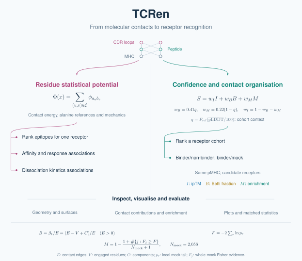

tcren: structure, recognition and ranking
=========================================

TCRen provides two routes from TCR–pMHC structures to experimental comparisons:

* **Statistical contact potentials:** rank candidate epitopes and relate structural
  readouts to measured affinity, response or kinetic endpoints. Start with
  :doc:`ranking`; use :doc:`evaluation` for matched experimental comparisons.
* **Confidence, topology and enrichment:** combine ipTM, recognition graph cycles
  and mock-calibrated contact enrichment to rank candidate receptors against one
  fixed pMHC. Evaluate supplied binder/nonbinder or binder/mock labels on the
  declared population. Start with :doc:`getting-started` and :doc:`screening`.

The inspection toolbox exports contact chemistry, residue contributions, geometry
and pMHC surfaces. Use :doc:`kit` to interpret a model, :doc:`features` to choose
an export, and :doc:`gallery` for molecular views.

.. code-block:: console

   $ tcren screen -s models.tar.gz --confidence confidence.tsv -o scores.tsv

The default TCR score's weights depend on the unlabelled cohort mean pLDDT.
Ranking scores are dimensionless; experimental associations do not calibrate
them into binding probabilities, affinities or kinetic rates.

Learn with a worked example
---------------------------

.. toctree::
   :maxdepth: 1

   notebooks/confidence_motif_score
   gallery

Complete a task
---------------

.. toctree::
   :maxdepth: 1

   getting-started
   reproduction
   ranking
   md-validation
   performance

Understand the result
---------------------

.. toctree::
   :maxdepth: 1

   kit
   fit-free
   motif-confidence
   motif-mixture
   residue-surprise
   beyond-the-contact-sum
   background

Look up definitions and APIs
----------------------------

.. toctree::
   :maxdepth: 1

   screening
   mhc-annotation
   features
   descriptor_table
   potentials
   contact-penalties
   prediction
   associations
   evaluation
   modules
   cdr3-neighborhood
   ATOM_PATTERN_SPEC
   INVENTORY_PATTERN_SPEC
   CHEMICAL_CORE_SPEC
   experimental-ranking
   oracle
   assess
   potts
   reliability

.. toctree::
   :hidden:

   notebooks/tcrvdb_frozen_score_reproduction

   notebooks/complementarity_map_2d
   notebooks/pocket_cdr_3d
   notebooks/canonical_frame_figures
   notebooks/pymol_canonical_figures
   notebooks/contact_thresholds_and_bondtypes
   notebooks/mhc_pseudosequence_mps
   notebooks/example_gil_a02_rs_motif
   notebooks/surface_topology

* :ref:`genindex`
* :ref:`modindex`
