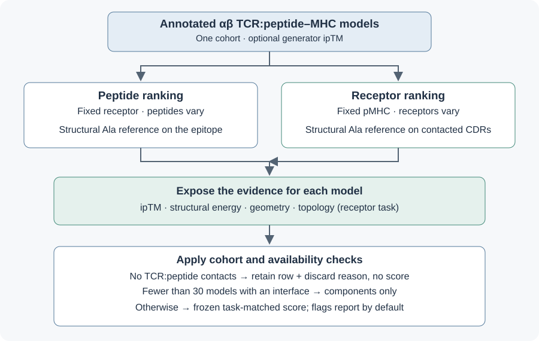
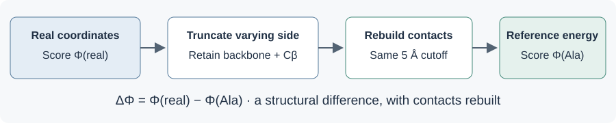

Screen a cohort
===============

``tcren screen`` ranks separately modelled candidate complexes for one task.
It reports each model's components, a frozen task-matched combination where the
cohort supports one, and the reasons a score is unavailable.

.. code-block:: console

   $ tcren screen -s models.tar.gz -o scores.tsv
   $ tcren screen -s models.tar.gz --confidence confidence.tsv -o scores.tsv

Choose the task and cohort
--------------------------

A cohort holds one side fixed: one receptor with varying peptides is epitope
ranking; one pMHC with varying receptors is TCR ranking. Automatic detection uses
the annotated peptide sequence and CDR3 pair. Keep the MHC background consistent;
this identity check does not establish experimental restriction or binding.
A mixed set, or a set in which neither side varies, is refused with a diagnostic.
``--task epitope`` or ``--task tcr`` declares a task but does not override that check.

The four exposed components
---------------------------

**Confidence:** ``iptm`` is the generator's interface predicted TM score, supplied
from the input set's metadata or a unique ``complex.id``/``iptm`` table passed with
``--confidence``. tcren does not compute it. Missing confidence is reported.

**Energy:** a directed statistical contact potential sums residue-pair entries on
the observed TCR:peptide contact map:

.. math::

   \Phi_{\mathrm{TP}}(x)=\sum_{(u,v)\in\mathcal C_{\mathrm{TP}}(x)}\phi_{a_u b_v},
   \qquad
   \Delta_s\Phi_{\mathrm{TP}}(x)=\Phi_{\mathrm{TP}}(x)-\Phi_{\mathrm{TP}}(A_s x).

Here :math:`x` is one annotated structure, :math:`\mathcal C_{\mathrm{TP}}(x)` its
residue contacts at a closest-heavy-atom cutoff of 5 Å, :math:`u` a TCR residue,
:math:`v` a peptide residue, and :math:`a_u,b_v` their amino-acid identities.
:math:`\phi_{ab}` is the directed TCRen2 table entry. :math:`A_s` truncates the
selected side :math:`s` to alanine in three dimensions, retaining backbone and
Cβ atoms, and rebuilds the map at the same cutoff. The energy is a dimensionless
statistical contact quantity; lower differences are the declared favourable direction.

The substituted side follows the side that varies. Epitope ranking uses
``dPhi_tcr_pep`` from peptide substitution; TCR ranking uses
``dFT_tcr_pep_cdr`` from CDR substitution. A fixed-map virtual identity substitution
is a different quantity. ``screen`` always computes the structural reference.

**Geometry:** ``sc_shape`` is the Pearson correlation between finite paired height
samples of the pMHC face and receptor underside in the same frame:

.. math::

   r_h=\frac{\sum_{k\in\mathcal K}(h_k-\bar h)(t_k-\bar t)}
   {\sqrt{\sum_{k\in\mathcal K}(h_k-\bar h)^2}\sqrt{\sum_{k\in\mathcal K}(t_k-\bar t)^2}}.

:math:`\mathcal K` contains the paired interface cells, :math:`h_k,t_k` are their
heights in Å and the bars denote means on those cells. The correlation is
dimensionless; degenerate or insufficient samples are unavailable, not neutral zero.
See :mod:`tcren.topology.surface` for grid and contact-plane definitions.

**Topology:** ``g_cyclo_frac`` is the CDR:pMHC residue-graph cycle fraction:

.. math::

   g_{\mathrm{cyclo}}=\frac{E-V+C}{E}, \qquad E>0.

:math:`E` counts unique residue-contact edges, :math:`V` contacted vertices and
:math:`C` connected components. The graph contains CDR:peptide and CDR:MHC edges.
This dimensionless graph quantity is carried in the TCR-ranking combination;
topology is excluded from the epitope-ranking combination.

Frozen standardization and combination
--------------------------------------

For each observed component :math:`i`, its frozen mean :math:`\mu_i`, positive
scale :math:`\sigma_i`, declared direction :math:`d_i\in\{-1,+1\}` and fixed weight
:math:`w_i\geq0` give

.. math::

   z_i=d_i\frac{x_i-\mu_i}{\sigma_i}, \qquad
   S=\frac{\sum_{i\in\mathcal O}w_i z_i}{\sqrt{\sum_{i\in\mathcal O}w_i^2}}.

:math:`x_i` is the raw value and :math:`\mathcal O` contains the observed components.
Missing values are omitted from both sums. The combination is unavailable when
no weighted contribution remains. Higher :math:`S` is the declared favourable
direction. It is dimensionless and unbounded, not a binding free energy or a
calibrated probability. Dependence among components is not a claim of independent
evidence or a calibrated Stouffer significance test.

The bundled references use confidence weight 0.8 for TCR ranking; energy, geometry
and topology share the remaining 0.2 equally. Epitope ranking uses confidence and
energy with weights 0.5 each. ``--weight`` explicitly changes the confidence weight
within [0,1]; the structural components share the remainder.

Means and scales are empirical reference dependencies estimated on a held-out pool
of 729 models over 14 off-panel epitopes, without reading labels for those moments.
Signs are declared a priori; saved labelled training diagnostics check them.
The TCR confidence weight is an explicit design choice informed by recorded
evaluation, not a prospectively validated learned coefficient. See ``SOURCES``
and :doc:`fit-free` for the dependency contract. Query rows never re-estimate
these constants, so a row's numerical combination does not depend on its neighbours.
The cohort governs whether that score is emitted.

Optional confidence orthogonalization
-------------------------------------

A reference may carry a frozen ``confidence_rho`` on a structural component. Where
it does, that component enters the combination with its confidence-explained part
removed and its scale restored:

.. math::

   z_i^{\perp}=\frac{z_i-\rho_i z_{\mathrm{conf}}}{\sqrt{1-\rho_i^{2}}},
   \qquad \rho_i\in(-1,1).

:math:`\rho_i` is the frozen within-cohort Pearson correlation between the
standardized component and the standardized confidence, both already on the
reference's own scale, so it is dimensionless and no label enters it. The subtraction
alone would shrink the component's spread; the divide puts it back on the scale the
fixed weights were chosen for. Without it a nominal structural weight of 0.2 buys
:math:`0.2\sqrt{1-\rho^{2}}` of independent evidence rather than 0.2.

This is a change of basis, not new evidence: :math:`z_i` and
:math:`z_{\mathrm{conf}}` span the same space before and after, so no ranking
follows from the subtraction by itself. What changes is what the fixed weights mean,
and therefore what a given weight is worth.

Rows whose confidence is missing keep :math:`z_i` unchanged — there is nothing to
project out of them — and ``confidence_orthogonalized`` reports per row whether the
correction was applied. The column is emitted only by a reference that carries the
key. The bundled references do not, so their scores are unchanged.

Discard and cohort floor
------------------------

Models with zero TCR:peptide contacts remain in output with ``no_interface`` true
and a reason in ``score_unavailable``, but no score. They do not count toward
``--min-cohort`` (default 30). Below the floor every row retains its component
readouts without a combined score. A flag response cannot restore discarded or
withheld scores or erase their original unavailability reasons.

Generator confidence reports pose quality; a binder-labelled pair may still have
an off-groove prediction. Reversing such a score would reward modelling failure.
Inspect model quality and provenance before interpreting discordant labels.

Flags and explicit responses
----------------------------

Flags report by default. ``small_cohort`` describes the scorable floor;
``no_interface`` reports zero-contact models; ``low_confidence`` compares cohort
mean ipTM with the frozen reference distribution; ``confidence_disagrees`` reports
opposing confidence and structure rankings. ``forced_pose`` is unavailable unless
strain is standardized against the population used for its reference cut.

``cohort_confidence_z`` is the standardized cohort mean, using the frozen
per-epitope mean 0.74562 and scale 0.035717; ``low_confidence`` fires below -0.6.
These stored constants describe the reference, not query-derived parameters.
A flag is an applicability observation, not a binding label or a validated correction.

``--on-flag`` controls the response to low confidence:

* ``report`` (default): retain the score and report the flags.
* ``structure``: omit confidence from the combination.
* ``geometry``: report the standardized geometry contribution as the score.
* ``withhold``: withhold the combined score.
* ``reverse``: negate the score; opt-in and not recommended as a modelling correction.

Responses change only the combined score. Raw components and missingness remain
visible; ``flag_response`` and ``flag_response_reason`` record an applied response.
References lacking a geometry component cannot use the geometry response.

Output and interpretation
-------------------------

The TSV keeps ``complex.id``, raw components, ``z_*`` contributions, ``missing_*``
flags, ``n_components``, ``screen_score`` and ``score_unavailable``. Cohort flags,
confidence statistics and zero-contact counts accompany each row. The provenance
sidecar records the task, reference hash, confidence weight, floor and flag response.

For receptor ranking, keep ipTM primary and read the structural components beside
it. The combination is complementary evidence, not an established universal
improvement. Report template coverage separately. Peptide-intrinsic surface
properties and a high CPL ranking alone do not establish receptor specificity.
Scientific evaluation, figures and historical results belong to the manuscript
and benchmark records; this page specifies the software's current behavior.

Library API
-----------

.. automodule:: tcren.screen
   :members:
